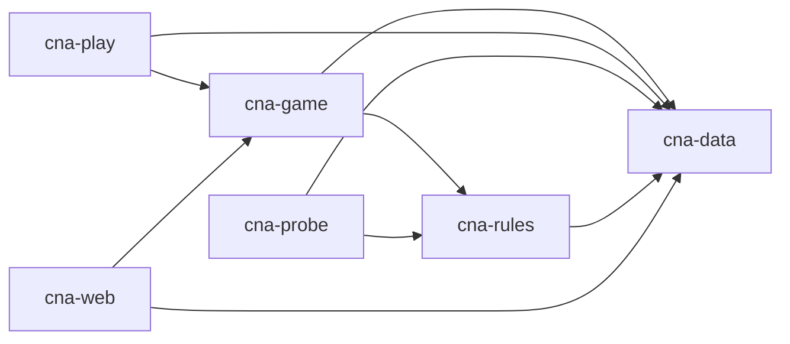
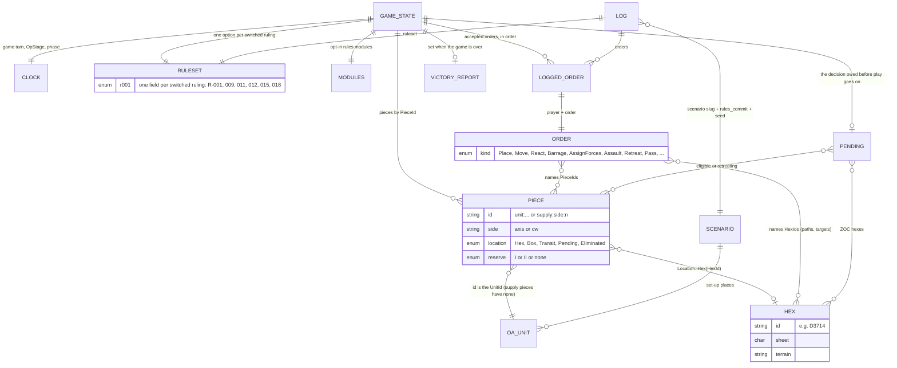
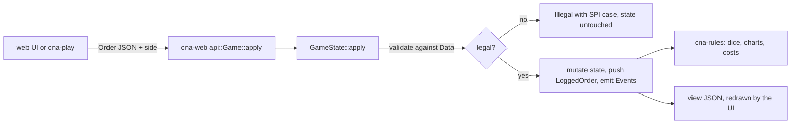

# Architecture

cna-engine is the rules engine for a digital *Campaign for North Africa*, built for Brian and the
group he plays with. It reads the rulebook from the sibling `cna` repo (a git submodule at
`vendor/cna`, consumed as JSON) and turns it into a deterministic game: a rules core, a headless
game state for one scenario (Graziani's Offensive), and a local browser client. It is not a
server (none exists yet), not an AI, and not the rules themselves: `cna` owns every rule's prose,
chart and ruling, and this repo never copies them.

Verified against e6314a6 on 2026-10-14.

Read `README.md` for setup and commands, `NOT_SIMULATED.md` for what the engine leaves out, and
`AUTOPILOT.md` for the mission queue an unattended agent works through here.

## Codemap

| Path | Owns | Entry point |
|---|---|---|
| `vendor/cna` | the rulebook as data (submodule of `basmith7/cna`); never edited here | `data/` |
| `crates/cna-data` | typed loaders for `vendor/cna/data`: map, tables, OA sheets, scenario | `source::Source`, `Map::load_from`, `Scenario::load_from` |
| `crates/cna-rules` | the rules core: dice, close assault, barrage, anti-armour, cohesion, movement costs, and the ruling switches | `ruleset::Ruleset` |
| `crates/cna-game` | the game state for one scenario: pieces, clock, orders, events, movement, combat, victory, the replayable log | `state::GameState::apply` |
| `crates/cna-play` | headless CLI over `cna-game`, files in and out | `src/main.rs` |
| `crates/cna-probe` | ruling probes: measure how a ruling's options differ, write `probes/*.json` | `src/main.rs`, `probes::all` |
| `crates/cna-web` | `cna-game` compiled to WebAssembly with the data embedded; JSON strings in and out | `lib.rs` (`Game`), `api.rs` |
| `web/` | Svelte 5 + Vite client; draws the engine's `view()`, sends `Order` JSON back | `src/engine.ts`, `src/App.svelte` |
| `probes/` | generated: committed probe output for the `cna` decision board | `cna-probe run` |
| `tests/games/` | scripted games (orders + pinned results) that tests replay | `golden.rs` regenerates them |
| `tools/archdoc` | generator for this file's marked blocks (own tiny crate, not a workspace member) | `src/main.rs` |
| `docs/designs`, `docs/plans` | per-mission specs and per-slice plans: the rationale this file links to | |
| `docs/autopilot` | the autopilot's `PROGRESS.md` (status, requests for cna) and `JOURNAL.md` | |

Crate layering (generated; edges are normal dependencies between workspace crates):

<!-- generated:crate-graph -->

<!-- /generated:crate-graph -->

## Data model

The game's types are Rust types, hand-mapped here; there is no schema file for engine state. The
map, OA sheets and scenario are *static data* (`cna_data::Data`, loaded once); the *state* is a
`GameState`, which refers to that data by id (`HexId`, `UnitId`) and never copies it. Source of
truth: `crates/cna-game/src/state.rs` (`GameState`, `Pending`, `Modules`), `piece.rs` (`Piece`,
`Location`), `order.rs` (`Order`, `LoggedOrder`), `log.rs` (`Log`), `clock.rs` (`Clock`),
`event.rs` (`Event`), `crates/cna-rules/src/ruleset.rs` (`Ruleset`), `crates/cna-data/src/map.rs`
(`Hex`) and `oa.rs` (`Unit`).

Things the diagram flattens:

- **Rulings are switches.** `Ruleset` has one enum per ruling that has options; the `switches!`
  macro in `ruleset.rs` is the one list (`SWITCHED`). Rulings without a switch are either
  decided in code (the "implemented as decided" table in `NOT_SIMULATED.md`, each naming the
  function that enforces it) or not simulated yet. A test in `ruleset.rs` enforces that every `cna` ruling has a
  switch or a row in `NOT_SIMULATED.md`.
- **A game is its log.** `Log` = scenario + ruleset + modules + seed + accepted orders. Replaying
  it on the same `vendor/cna` commit gives the same state byte for byte (`rng.rs` is seeded
  ChaCha). `GameState` also carries the log, so a save is the whole game.
- **Pending and sealed steps.** `Pending` is the state machine's "someone owes an answer" slot;
  `Pending::Sealed` collects both players' secret combat answers (gun positions, barrage, force
  assignment) and reveals them only when both are in.
- **Modules.** `Modules::abstract_supply` gates rules added after saves existed; off, an old
  save or log replays as it always did.

## Interfaces

**There is no HTTP or WebSocket server in this repo.** The multiplayer server (queue row 4 in
`AUTOPILOT.md`) is a spec awaiting Brian's review and none of it is built. Today the engine is
driven three ways, all by `Order` JSON in and events/state JSON out.

**WebAssembly API** (`crates/cna-web/src/lib.rs`, the `Game` class, wrapped in `web/src/engine.ts`):
`newGame(seed)`, `load(json)` and `save()` (the state JSON is the save format; `load` refuses
another scenario or `vendor/cna` commit), `view()` (state shaped for drawing), `placements(piece)`
(legal set-up hexes), `reachable(side, pieces, purpose)` (hexes a stack can end a move in),
`sealedOptions(side)`, `apply(side, order)` (the only thing that changes state; illegal orders
come back as `{"illegal": ...}` with the SPI case), `preview(side, order)` (the same, state
untouched), `rulesCommit()`. Logic lives in `api.rs` so native tests see the same bytes.

**CLI** (`crates/cna-play/src/main.rs`): `new <scenario> [--seed N] [--no-abstract-supply] [-o]`,
`apply <state> <orders>`, `show <state>`, `log <state> [-o]`, `replay <log> [-o]`.
(`crates/cna-probe/src/main.rs`): `run` writes `probes/<id>.json`; `check` fails if any is stale,
missing or orphaned (CI runs it).

**Browser storage and files:** the autosave in `localStorage` under `cna:autosave`
(`web/src/saves.ts`); downloaded saves `graziani-gt<N>-os<M>.json`; `Log` JSON from `cna-play log`.

**What `cna-data` reads from `vendor/cna/data`** (via `Source`; `Fs` natively, `MemSource` or the
build-time embedded copy in the browser): `map/` (hexes, sheets, hexsides, places), `tables/`
(terrain, CP, weather, stacking, combat charts, morale, weapons, unit characteristics, schedule,
and so on), `oa/` (order-of-appearance sheets), `scenarios/<slug>.json`, `errata/`. Those five
directories are exactly what `cna-web/build.rs` embeds. `cna_data::rules_commit()` asks git for the
submodule's HEAD, which is stamped into probes, saves and logs. `rulings/` is read by a test
that checks every ruling has a switch or a row in `NOT_SIMULATED.md`.

## Features

What is playable, honestly. `NOT_SIMULATED.md` is the authority on gaps.

- **Graziani's Offensive, Land Game only, headless and in a browser.** Set-up with free
  placements, initiative and weather, movement (CP, terrain, roads, stacking, ZOC, reaction,
  reserves), all six combat steps with sealed answers, and victory at the end of Game-Turn 6 with
  a report. Every order is validated; illegal ones are refused with the SPI case. Starts at
  `GameState::new`, `cna-play new`, or the start screen in `web/`. Specs:
  `docs/designs/2026-10-08-game-state-design.md`, `docs/designs/2026-10-13-minimal-ui-design.md`.
- **Ruling probes.** Eight probe files measuring how options of R-001, 009, 011, 012, 015, 018 and
  chart oddities differ in play, for the `cna` decision board. Design:
  `docs/designs/2026-09-26-engine-probes-design.md`.
- **Save, load, replay.** State JSON round-trips; a log replays byte for byte on the same
  commit; hostile or hand-edited saves are errors, not panics.
- **Abstract supply (partial, in progress).** Slice 1 landed behind `Modules::abstract_supply`:
  supply units carry loads, motorisation points exist, stacking and AA thinning apply. On by default
  in `cna-play new`, off in the browser (`api::Game::new`) until its panels land. Nothing *spends* them yet: fuel and ammunition
  spending is Mission 5 slice 2, an open draft PR. Spec: `docs/designs/2026-10-13-land-turn-design.md`.
- **Planned, not built:** the rest of the Land Game turn (organisation, breakdown, repair,
  engineering, patrols, rail, convoys, dumps, prisoners), Logistics Game, Air Game, other
  scenarios and the campaign, AI players, and the multiplayer server with accounts, lobby and real
  hidden information (Mission 4, spec only). Until the server, **secrecy is hot-seat only**: the
  state in the page and the autosave hold everything.
- **Not goals:** hosting anything; the UI enforcing a rule (it holds none).

## Flows

One order, in any front end:

Data path: `vendor/cna/data` -> `cna-data` loaders -> `cna_game::data::Data` -> `GameState`. In the
browser, `cna-web/build.rs` embeds the same files at compile time, so `Data` is identical.

## Invariants and gotchas

- **The engine is the only rules authority.** `web/` shows only what `placements`, `reachable`
  and `sealedOptions` return; `apply` alone judges. Add rules in `cna-game`/`cna-rules`, never
  the UI.
- **Determinism.** Same scenario, ruleset, modules, seed, orders and `vendor/cna` commit give the
  same state. Use the game's RNG (`rng.rs`), never anything ambient. Iteration over state uses
  `BTreeMap`/`BTreeSet` for this reason.
- **Bumping `vendor/cna` breaks pinned things on purpose.** Probe files, saves, and the scripted
  games in `tests/games/` record the commit; `cna-probe check` and the replay tests fail until
  regenerated (`cargo run -p cna-probe -- run`; the `--ignored regenerate_*` tests in
  `cna-game`, then re-pin the hash the short game prints).
- **Do not edit `vendor/cna`.** Missing or ambiguous rules go in *Requests for cna* in
  `docs/autopilot/PROGRESS.md`.
- **New rules go behind `Modules`** (or a `Ruleset` switch) so old saves and logs still replay.
- **Generated blocks:** the crate graph above is written by `tools/archdoc`; do not hand-edit it.
- **A ruling needs a home.** Adding or changing a ruling in `cna` fails the all-rulings test until
  it has a switch, a "decided" row, or a "no switch" row in `NOT_SIMULATED.md`.
- **Autopilot is working in this repo.** Check open PRs and `docs/autopilot/PROGRESS.md` before
  large edits; keep changes small and additive.
- **`NOT_SIMULATED.md` lags slightly:** its "Abstract supply" row still says every unit has
  unlimited supply, which is true of spending but not of the loads slice 1 added.
- `web/src/pkg` (the built wasm) is generated by `npm run wasm` and not committed.
- Crate-wide, `cargo clippy --all-targets -- -D warnings` must pass; CI also builds `cna-game`
  for `wasm32-unknown-unknown`.

## Where to start

- **A rule's numbers or a ruling switch:** `crates/cna-rules` (`ruleset.rs`: a new option enum and
  a line in `switches!`, then the module that uses it); delete the ruling's row from
  `NOT_SIMULATED.md`, and expect pinned games to need regenerating; probe it in `crates/cna-probe/src/probes/`.
- **Movement or ZOC behaviour:** `crates/cna-game/src/movement.rs`, `reach.rs`, `zoc.rs`,
  `reaction.rs`; step costs live in `cna-rules/src/movement.rs`.
- **Combat:** `crates/cna-game/src/combat/` (`segment.rs` sequences the steps; `assault.rs`,
  `barrage.rs`, `retreat.rs`).
- **A new order or phase:** `order.rs` (`Order`), `state.rs` (`apply`), `phases.rs`/`cycle.rs`,
  then the matching UI panel in `web/src` and `web/src/types.ts`.
- **The browser UI:** `web/src/App.svelte`, `engine.ts`, `types.ts` (mirrors the JSON; check
  `crates/cna-web/src/api.rs` for the shapes). Tests: `npm test`, `npx playwright test`.
- **Regenerate this file's graph:** `cargo run --manifest-path tools/archdoc/Cargo.toml`.
